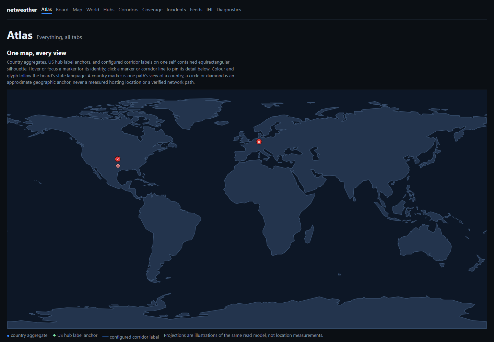
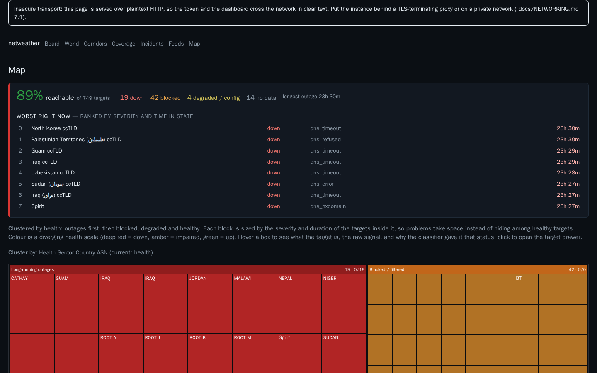
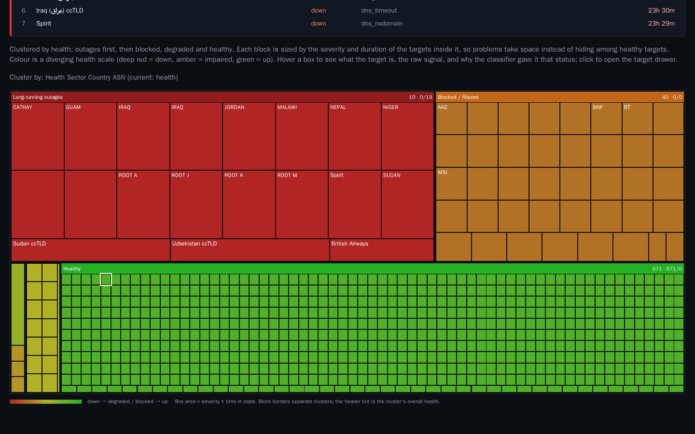
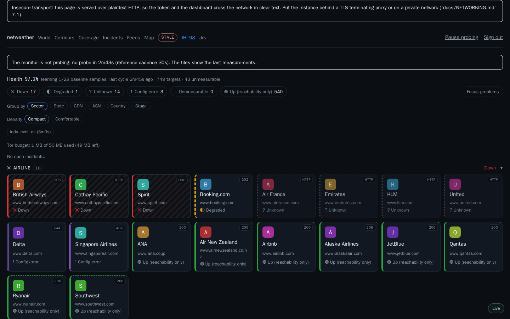
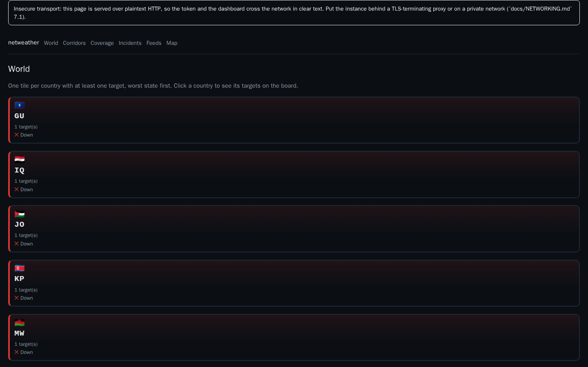

<div align="center">


# netweather

### A self-hosted internet weather station

*One small container that tells you whether the internet is on fire — and whether the fire is at your end.*

[](https://go.dev/)
[](LICENSE)
[](#container)
[](#safety-posture)
[](#screenshots)
[](https://doi.org/10.5281/zenodo.24503939)
[](https://github.com/Greg-2600/netweather/actions/workflows/ci.yml)
[](https://github.com/Greg-2600/netweather/actions/workflows/lint.yml)
[](https://github.com/Greg-2600/netweather/actions/workflows/codeql.yml)
[](https://github.com/Greg-2600/netweather/actions/workflows/e2e.yml)
[](https://github.com/Greg-2600/netweather/actions/workflows/azure_k3s.yml)

[Quick start](#quick-start) · [Features](#-features) · [Screenshots](#screenshots) · [Docs](#design-docs) · [Deploy](#deployment)

</div>

---

## The three questions

netweather answers these, in this order:

| # | Question | What it means |
|:-:|---|---|
| **1** | **Is something large happening right now?** | Cyberwar, mass outage, cable cut, BGP hijack, national shutdown |
| **2** | **Is a specific service or sector down?** | Banking, airlines, cloud, socials |
| **3** | **Is it me?** | My ISP, my DNS, my egress, my container |

> [!IMPORTANT]
> Most monitors answer only **#2**, and answer it badly: `curl != 200` becomes "down." That produces enough false alarms that people stop looking. netweather **classifies bot protection instead of evading it**, and refuses to call a single vantage point a global truth.

**Status: phases 0–3 implemented** (OIDC deferred to *Later*). The binary probes configured targets over HTTP, TLS, TCP, DNS, DoH, DoT, QUIC (UDP/443 reachability), NTP, and ICMP on a tiered scheduler; classifies each result; writes to SQLite; and serves a store-backed board with live SSE updates, the versioned API, and a hardened container image.

Incidents with chronological detail timelines, baseline anomalies, coverage, self-checks, exports, feeds (IODA, Radar, Statuspage, AWS, GCP, Azure, Atlas, RIPE RIS Live), ASN/CDN/PeeringDB enrichment, certificate issuer pinning, per-resolver DNS divergence, provider status mapping, idempotent actions, on-demand traceroute, the world view, configuration-driven corridors with captured traces, the Internet Health Index, SSE replay, a Feeds status page, a FinViz-style **treemap health map**, and a map-first **`/atlas` view with everything, all tabs** are all implemented. Tor vantages (six pinned exits) are on by default in compose; Tailscale is a compose profile; traceroute and RIPE's software probe have their own opt-in overlays. Remote vantage agents (`netweather agent`) run the same instruments on a remote host and report to `/api/v1/vantages/{id}/reports`.

> [!NOTE]
> **Known limits, stated rather than hidden:** QUIC is UDP/443 reachability, not a full handshake; the DF-bit PMTU probe is Linux-only; IPv6 measurement runs under host networking only; RIS Live is a polling adapter (WebSocket is post-MVP); IODA shows stored events, not a live per-country score. `NETWEATHER_SEED=none` starts with an empty board.

Everything builds and tests with one command: **`go run ./internal/devtool verify`**.

---

## Table of contents

- [✨ Features](#-features)
- [🚀 Quick start](#quick-start)
- [📸 Screenshots](#screenshots)
- [🔍 At a glance](#-at-a-glance)
- [📦 Container](#-container)
- [⚙️ Configuration](#️-configuration)
- [🛠️ Operations](#️-operations)
- [🚢 Deployment](#-deployment)
- [🛡️ Safety posture](#️-safety-posture)
- [📚 Design docs](#design-docs)
- [🧬 Prior art](#-prior-art)
- [👥 Contributors](#-contributors)
- [📄 License](#-license)

---

## ✨ Features

| | Capability | What it gives you |
|:--:|---|---|
| 🗺️ | **Health treemap** | `/map` clusters long-running outages → recent outages → blocked → degraded → no data → healthy, packed most-urgent first. Area grows with severity × duration; hover cards explain *why* a tile has its status. |
| 🌍 | **Atlas** | `/atlas` puts a combined country/hub/corridor map first, then every tab's data below. It reuses the same server-side builders as the individual pages, with CSS hover cards and click-to-pin details; no external scripts, inline scripts, or runtime fetches. This page is unrelated to the optional RIPE Atlas feed. |
| 🏙️ | **US hubs** | `/hubs` maps real airport and city-portal targets with the same health treemap as `/map`: city blocks, one box per endpoint, worst first. City/state come from a name convention — no schema change. |
| 🧭 | **Vantages** | `direct` (your connection) plus optional `socks5` Tor corroboration, including multiple pinned exit countries across continents. Only the primary vantage may declare `DOWN`. |
| 🔬 | **Honest classification** | `UP` · `UP_REACHABILITY` · `DEGRADED` · `DOWN` · `BLOCKED` · `UNKNOWN` · `CONFIG_ERROR` · `UNMEASURABLE`. The last three never count against health — that is what keeps the board from being permanently on fire. |
| 🌐 | **External intelligence** | IODA, Cloudflare Radar, the Statuspage family (AWS/GCP/Azure), RIPE RIS Live, Atlas, PeeringDB. All optional; the core works with zero feeds. |
| 🧪 | **Seven test layers** | Unit, classifier fixtures, fake internet, API, container, real-endpoint E2E, and opt-in browser (Playwright) — plus fuzzing, mutation testing, and per-package coverage gates. |
| 🔒 | **Hardened by default** | Read-only rootfs, non-root UID 65532, all capabilities dropped, one published port, SSRF guards after DNS *and* redirects, no telemetry. |

> [!TIP]
> This is **not** a Downdetector clone (you are one vantage point, and the UI never claims otherwise), **not** a homelab uptime monitor (use Uptime Kuma or Gatus for that), **not** a scraper/load tester/port scanner ([acceptable use](docs/ACCEPTABLE_USE.md)), and **not** a paging system.

---

## 🚀 Quick start

```sh
mkdir -p data secrets
printf '%s' "$(openssl rand -hex 32)" > secrets/ui_token
chmod 600 secrets/ui_token
sudo chown -R 65532:65532 data   # Linux bind mounts only; the image owns /data
docker compose up -d
```

When the Compose secret is a bind mount, `secrets/ui_token` must be readable
only by the container user: mode `600` and UID `65532:65532`. Docker Desktop
cannot represent Linux ownership modes on Windows bind mounts, so the deploy
scripts copy the token into a volume owned by UID 65532 instead. A manual
Compose deploy must prepare the file or secret volume before startup; otherwise
the app crash-loops with a token-file permission error.

Open <http://localhost:2600> and log in with the token you just created. That's it — the full 1000-target field-trial fleet with six pinned Tor exits across five continents, each with its own 50 MB/day cap.

Want the operator wrapper as well (0600 secret volume, evidence feeds, `/healthz` gate, image rollback)?

```powershell
.\scripts\deploy_fieldtrial.ps1               # Windows: build + deploy
.\scripts\deploy_fieldtrial.ps1 -DryRun       # print commands, touch nothing
```

```sh
./scripts/deploy_fieldtrial.sh                # Linux/macOS/CI: same deploy
./scripts/check_fieldtrial.sh                 # health, 1000 targets, auth, map, hubs, corridors, feeds, Tor
```

---

## Screenshots

All shots are from the local field-trial deploy — 1000 real targets, no mocked data.

**Atlas — everything, all tabs** — the primary `/atlas` view combines the
world, US hubs, corridors, board, treemap, coverage, incidents, feeds, IHI,
and diagnostics on one page:



**Health treemap at `/map`** — outages first, largest and reddest longest-standing:



**Hover any tile** for the identity and a plain-English reason behind its status:



**Board** and **world view**:

| Dashboard | World |
|---|---|
|  |  |

The world view also places its country health markers on a self-contained
equirectangular projection above the tiles, with approximate city anchors for
the US hub labels. Those anchors are not verified hosting locations.

`/corridors` uses the same projection above its table: configured operator
labels become approximate city-centre anchors, and a straight line links each
known pair, wrapping at the antimeridian. The line is a visual link only, not a
measured route or a claim about any physical or undersea cable.

Every page is server-rendered HTML + SSE — no JS framework, no build step.

---

## 🔍 At a glance

**Targets** — four classes, 1000 probes in the field-trial config:

| Class | Count | Job |
|---|---|---|
| Service | 406 | Sector health (banking, airlines, telecom, cloud, …) |
| Country anchor | 459 | ccTLD nameservers — "is country X still on the internet?" |
| Network anchor | 125 | Root-zone glue DNS servers and public resolvers |
| Reference | 10 | The "is it me?" baseline |

**Verdicts** — `OK` · `INCIDENT` · `REGIONAL` · `LOCAL` · `TAMPER` · `STALE` · `LEARNING`

**Instruments** — DNS, DoH, DoT, QUIC, TCP, TLS, HTTP(S), ICMP, TCP-ping, NTP, traceroute (on-demand only)

**Stack** — Go, SQLite (pure Go), server-rendered HTML + SSE. One binary. No JS build step, no framework. Browser tests use Playwright.

The early field-trial fleet is pre-generated at [`config/fieldtrial-targets.yaml`](config/fieldtrial-targets.yaml): **1000 real targets** (459 ccTLD anchors, 125 network anchors, 406 services, 10 references), rebuilt from the IANA root zone by [`scripts/gen_fieldtrial_targets.py`](scripts/gen_fieldtrial_targets.py). The extra anchors are second delegated NS records and distinct root-zone glue IPs; the extra services are egress-verified public endpoints that deepen telecom, government, health, and education coverage. Every original id is preserved. `netweather seed --diff` prints what a seed would change without writing anything.

---

## 📦 Container

One monitor container plus six client-only Tor sidecars, each read-only, non-root, and shell-free in the release images. Outbound for probes; **inbound only on 2600** for the dashboard.

The monitor is built from [`Dockerfile`](Dockerfile) (Chainguard Go builder → static runtime, ~25 MB, no shell) and orchestrated by [`compose.yaml`](compose.yaml). It binds `./data:/data` and `./config:/config:ro`, publishes only `2600`, runs read-only with `cap_drop: ALL`, and enables unprivileged ICMP via `ping_group_range`. The six pinned Tor sidecars start with it by default.

Everything else optional is a **compose profile**:

| Profile | Purpose |
|---|---|
| `tor` | Optional single unpinned Tor sidecar; the six pinned exits are on by default |
| `tailscale` | Tailnet access without publishing a port |
| `ripe-atlas` | RIPE's own probe, separate trust domain |
| `compose.trace.yaml` | On-demand traceroute overlay (`CAP_NET_RAW`) |
| `compose.ipv6.yaml` | IPv6 measurement under host networking |

A plain `docker compose up -d` starts the six pinned `tor-de/jp/au/sg/cl/mx`
sidecars built from `Dockerfile.tor`, and `NETWEATHER_TOR_VANTAGES` in
`compose.yaml` points the monitor at their SOCKS endpoints. None publish ports;
they remain on the `egress` network and are isolated from the UI network. A
country label is added only after the app verifies the real exit through that
proxy. The sidecars do not turn an instance into an exit relay.

The optional `tor` profile adds the original unpinned `netweather-tor:local`
sidecar for a single `tor` vantage; it stays idle while
`NETWEATHER_TOR_VANTAGES` is set.

**Port 2600** — 2600 Hz, phreaking, *2600: The Hacker Quarterly*; unassigned by IANA and above 1024 so the non-root UID can bind it without `NET_BIND_SERVICE`. Full rationale in [`docs/NETWORKING.md`](docs/NETWORKING.md) §7.1.

`0.0.0.0` is the default bind, and that is fine — but an unauthenticated dashboard is not. A non-loopback listen with `ui.auth: none` refuses to start unless `ui.allow_public: true` is *also* set. The page publishes your target list, egress ASN, and coverage gaps; that is the disclosure, not the HTML.

> [!WARNING]
> **Verify the image before running it.** Releases are multi-arch, signed with cosign keyless, and carry SBOM and provenance attestations ([`docs/IMAGE.md`](docs/IMAGE.md) §6). Pin the digest, not a tag:
>
> ```sh
> cosign verify ghcr.io/Greg-2600/netweather@sha256:<digest> \
>   --certificate-identity-regexp 'https://github.com/Greg-2600/netweather/.*' \
>   --certificate-oidc-issuer https://token.actions.githubusercontent.com
> ```

Container networking is not an afterthought here: Docker's bridge defaults, embedded DNS, and MTU will all silently produce fake outages if unhandled. [`docs/NETWORKING.md`](docs/NETWORKING.md) covers the topology, the PMTU check, the SSRF reachability map, and Tailscale/reverse-proxy access.

---

## ⚙️ Configuration

The shipped `compose.yaml` sets `NETWEATHER_CONFIG=/config/fieldtrial-targets.yaml` (1000 targets); a bare binary with the variable unset uses fourteen shipped defaults. Point `NETWEATHER_CONFIG` at your own file (see [`config/targets.example.yaml`](config/targets.example.yaml)), or at a **directory** laid out as `netweather.yaml`, `sites/<sector>/*.txt`, `overrides/*.yaml`, and `corridors.yaml`; a sector is the file's path, so a large list needs no per-line tagging. `NETWEATHER_SEED=none` starts with an empty board. State lives in `NETWEATHER_DATA` (default `./data`). Config validation is strict: an unknown field, a blocked port, or an interval under 30s refuses to start.

Every environment variable the binary reads, including the ones that exist for a mirror or a test:

| Variable | Default | Meaning |
|---|---|---|
| `NETWEATHER_CONFIG` | shipped seed list | target file |
| `NETWEATHER_ROOT_ZONE_URL` | IANA root zone | endpoint override for `seed --country-anchors`; point it at a mirror |
| `NETWEATHER_CALENDAR` | `calendar.yaml` beside the target config | atypical-day calendar (`dates:` with `date:` and optional `regions:`; a listed day is excluded from baseline samples, a malformed file refuses startup) |
| `NETWEATHER_SEED` | `default` | `none` starts with an empty board |
| `NETWEATHER_DATA` | `./data` | SQLite database and rotated log file |
| `NETWEATHER_UI_LISTEN` | `0.0.0.0:2600` | HTTP bind address |
| `NETWEATHER_TRUSTED_PROXIES` | none | comma-separated CIDRs/addresses whose `X-Forwarded-For` is believed for limits and logs; a malformed entry refuses startup |
| `NETWEATHER_REDACT_EGRESS` | `false` | hides the literal egress address on `/api/v1/selfcheck` while keeping ASN and country |
| `NETWEATHER_UI_TOKEN` / `NETWEATHER_UI_TOKEN_FILE` | none | session and bearer token, minimum 16 characters; `_FILE` preferred and must be 0600/owned by UID 65532:65532 on the host when bind-mounted |
| `NETWEATHER_UI_SECURE_COOKIES` | `false` | `true` marks the session cookie `Secure`; set behind TLS |
| `NETWEATHER_CONTACT` | none | contact address in the probe `User-Agent`; unset logs `contact_missing` and sends a visible placeholder |
| `NETWEATHER_TRACE_ENABLED` | `false` | enables the on-demand traceroute action; the endpoint answers `503` until this and `CAP_NET_RAW` are set |
| `NETWEATHER_UI_ALLOW_PUBLIC` | `false` | allows a non-loopback bind with no token |
| `NETWEATHER_LOG_LEVEL` | `info` | `trace`, `debug`, `info`, `warn`, `error` |
| `NETWEATHER_LOG_FORMAT` | `auto` | `auto` (text on TTY, JSON otherwise), `text`, `json` |
| `NETWEATHER_LOG_FILE` | none | rotated file sink, written 0600 |
| `NETWEATHER_LOG_MAX_MB` / `NETWEATHER_LOG_KEEP` / `NETWEATHER_LOG_RING` | `50` / `3` / `2000` | rotation size, retained files, in-memory ring records |
| `NETWEATHER_LOG_SOURCE` | unset | `1` adds `source=file.go:line` to every record |
| `NETWEATHER_API_URL` | `http://127.0.0.1:2600` | base URL the CLI verbs use |
| `NETWEATHER_HEALTHCHECK_URL` | derived from `NETWEATHER_UI_LISTEN` | `/healthz` target for `netweather healthcheck`; non-loopback refused |
| `NETWEATHER_METRICS` | `false` | mounts `/metrics` (Prometheus text, aggregates only) |
| `NETWEATHER_INCIDENT_INTERVAL` | `5m` | incident and anomaly evaluation cadence |
| `NETWEATHER_DAILY_MB` | `2048` | direct vantage's daily egress budget; `0` disables it |
| `NETWEATHER_RATE_LIMIT` | `20` | global probe ceiling in req/s (fractional allowed; cold ramp starts at 2 req/s for 10 min) |
| `NETWEATHER_DNS_RETRIES` | `1` | extra UDP DNS attempts on timeout, clamped 0–2; shares the 5s budget, never retries answers |
| `NETWEATHER_DNS_RETRY_DELAY_MS` | `25` | pause between DNS attempts, clamped 0–200ms |
| `NETWEATHER_ENRICH` | on | `false` disables ASN, prefix, and CDN learning |
| `NETWEATHER_PEERINGDB` / `NETWEATHER_PEERINGDB_URL` | on | exchange-membership labels; `_URL` points at a mirror |
| `NETWEATHER_FEEDS` | none | comma list of `ioda`, `ioda-level`, `radar`, `statuspage`, `aws-status`, `gcp-status`, `azure-status`, `ris-live`/`ris` |
| `NETWEATHER_WEBHOOK_URL` / `NETWEATHER_WEBHOOK_SECRET` | none | incident open/close POST + optional `X-Netweather-Secret` |
| `NETWEATHER_VANTAGE_SIGNING_SECRET` | none | HMAC-SHA256 `X-Netweather-Signature` on vantage ingest |
| `NETWEATHER_VANTAGE_CLIENT_CA` | none | client CA for mTLS on the ingest path |
| `NETWEATHER_AGENT_SIGNING_SECRET` | none | agent-side shared secret (must match primary's) |
| `NETWEATHER_AGENT_CLIENT_CERT` / `NETWEATHER_AGENT_CLIENT_KEY` | none | agent client certificate/key for mTLS |
| `NETWEATHER_REMOTE_VANTAGES` | none | vantage ids a primary registers for remote agents |
| `NETWEATHER_SERVER_URL` / `NETWEATHER_VANTAGE` / `NETWEATHER_AGENT_TOKEN` | none / `remote` / none | primary URL, vantage id, and bearer token for `netweather agent` |
| `NETWEATHER_STATUSPAGE_URLS` | none | status pages for the `statuspage` feed; **HTTPS only** |
| `NETWEATHER_ATLAS_KEY` / `NETWEATHER_ATLAS_MEASUREMENTS` / `NETWEATHER_ATLAS_URL` | none | read-only RIPE Atlas adapter; key optional, measurement ids required, URL **HTTPS only** |
| `NETWEATHER_RADAR_TOKEN` | none | Cloudflare Radar API token; feed skipped with a warning without it |
| `NETWEATHER_RIS_ASNS` / `NETWEATHER_RIS_URL` | none / upstream default | ASNs for the RIS poller/stream; URL **HTTPS only** |
| `NETWEATHER_RIS_STREAM` / `NETWEATHER_RIS_WS_URL` | `false` / upstream default | opt-in real-time RIS Live WebSocket; **WSS only** |
| `NETWEATHER_IODA_LEVEL_LIMIT` | `25` | max ranked countries per `ioda-level` poll (clamped 1–100) |
| `NETWEATHER_IODA_SUMMARY_URL`, `NETWEATHER_IODA_URL`, `NETWEATHER_RADAR_URL`, `NETWEATHER_AWS_STATUS_URL`, `NETWEATHER_GCP_STATUS_URL`, `NETWEATHER_AZURE_STATUS_URL` | upstream defaults | endpoint overrides; **HTTPS only**, plaintext ignored with `event=feed_url_insecure` |
| `NETWEATHER_TOR` | off | enables Tor corroboration vantages |
| `NETWEATHER_TOR_SOCKS` | `127.0.0.1:9050` | single SOCKS5 entry point (`socks5h` only); compose uses `tor:9050` |
| `NETWEATHER_TOR_VANTAGES` | none | comma-separated `CC=host:port` list for pinned exits; shipped field-trial list: `DE=tor-de:9050,JP=tor-jp:9050,AU=tor-au:9050,SG=tor-sg:9050,CL=tor-cl:9050,MX=tor-mx:9050` |
| `NETWEATHER_TOR_MAX` | `25` | maximum Tor targets **per exit** |
| `NETWEATHER_TOR_DAILY_MB` | `50` | Tor daily volume budget **per exit**; `0` disables it |
| `NETWEATHER_TOR_EXIT_COUNTRY` | none | single-vantage code; the exit is verified through the proxy and a mismatch refuses that vantage |

---

## 🛠️ Operations

<details>
<summary><b>Backup, restore & upgrade</b></summary>

The release image has no shell, so the binary is the backup tool:

```sh
docker compose exec netweather /netweather backup -o /data/backup.db
docker compose cp netweather:/data/backup.db ./backup.db
```

`VACUUM INTO` writes a consistent, compact copy while the service runs; the file is `0600`, and an existing destination is refused rather than overwritten.

**Upgrade:** pull the new digest and restart. Migrations run in a transaction, and before a pending one the binary writes `netweather.db.pre-migration-v<from>-<timestamp>.db` beside the database. A database written by a newer binary refuses to open.

**Restore:** stop the service, replace `/data/netweather.db`, delete any `-wal`/`-shm` siblings, and start. Startup logs `event=db_wal_present` if it finds a WAL, because it cannot tell a crashed one from a stale one.

</details>

<details>
<summary><b>Logs & support bundle</b></summary>

`docker compose logs` carries everything at the configured level; `/diagnostics` (behind auth) shows the ring, drops, and active scopes. `netweather debug bundle -o bundle.tar.gz` collects build identity, redacted config, ring, self-checks, and failing targets' last probes. Enable verbose output for one target without going global:

```sh
docker compose exec netweather /netweather debug enable --target chase.com --level trace --for 10m
```

</details>

---

## 🚢 Deployment

`compose.yaml` alone now deploys the production-sized target file and the six pinned Tor vantages (DE, JP, AU, SG, CL, MX — five continents). The field-trial wrappers layer `compose.fieldtrial.yaml` on top for an external secret volume at `0600`/uid `65532`, bounded evidence feeds, a `/healthz` gate, and image-tag rollback. Each Tor exit is a separate client-only sidecar with its own verified country, probe subset, and budget; a failed exit is skipped without stopping the others. Both wrappers seed the secret, tag a rollback image, recreate the stack, wait for health, and roll back if unhealthy.

```powershell
.\scripts\deploy_fieldtrial.ps1               # Windows
.\scripts\deploy_fieldtrial.ps1 -NoBuild      # reuse existing images
```

```sh
./scripts/deploy_fieldtrial.sh                # Linux/macOS/CI
./scripts/deploy_fieldtrial.sh --dry-run
```

The overlay enables the bounded `ioda-level` feed: one ranked summary poll every five minutes stores at most 25 countries, and `/world` reads that stored snapshot rather than calling IODA per view. The displayed level is **relative** (log-scaled against the top-ranked country) and is shown beside IODA's raw score and event count — evidence, not a verdict or probability. The real-time RIS Live WebSocket is opt-in (`NETWEATHER_RIS_STREAM=true` + `NETWEATHER_RIS_ASNS`).

Verify or soak the running instance:

```sh
./scripts/check_fieldtrial.sh                          # health, fleet, auth, map, hubs, corridors, feeds, Tor
CYCLES=12 SLEEP=300 ./scripts/check_fieldtrial.sh     # ~1 hour soak
```

The token is read from `NETWEATHER_UI_TOKEN`, `TOKEN_FILE`, or the `nw-fieldtrial-secret` volume. `scripts/install-schedule.ps1` registers the field-trial deploy every two hours; the build is reproducible (`go run ./internal/devtool repro`), so a scheduled rebuild is cheap and the health gate means a broken build never replaces a working instance.

---

## 🛡️ Safety posture

This tool sends periodic requests to third-party sites. That is dual-use, so the limits are **enforced in code**, not documented and hoped for:

- 30s minimum interval per host, not configurable lower
- Per-host concurrency 1, a global rate ceiling (20 req/s steady, ramped from 2 req/s over ten minutes), and a 2 GB/day egress budget with a hard stop
- Outbound ports 80/443/53/123/853 only
- Inbound: `2600` only, and a non-loopback bind requires auth
- Private ranges blocked after DNS resolution **and** after every redirect
- Traceroute: on-demand or anomaly-triggered, ≤10 runs/hour
- Tor vantages: on by default in compose (six pinned exits, ≤25 targets and ≥2s spacing per exit, 50 MB/day budget per exit); the binary itself leaves Tor off unless enabled
- **No telemetry, ever**

At the full 1000-target field-trial fleet this is ~586k probes/day and ~1.1 GB/day, dominated by TLS handshakes. Details and arithmetic: [`docs/ACCEPTABLE_USE.md`](docs/ACCEPTABLE_USE.md) §4.

---

## 📚 Design docs

| Doc | Covers |
|---|---|
| [`docs/DESIGN.md`](docs/DESIGN.md) | Architecture, target classes, scheduler, state model, correlation, attribution, feeds, vantages, sectors/ASN/country, UI, storage, deployment, guardrails |
| [`docs/CLASSIFIER.md`](docs/CLASSIFIER.md) | The rule table that turns a response into a state — error classes, WAF signatures, precedence, confidence, golden fixtures |
| [`docs/IMAGE.md`](docs/IMAGE.md) | Container base image, two-image strategy, hardening, capabilities, supply chain |
| [`docs/NETWORKING.md`](docs/NETWORKING.md) | Docker topology, MTU/PMTU, embedded DNS, SSRF reachability, Tailscale and proxy access, Tor wiring |
| [`docs/QUALITY.md`](docs/QUALITY.md) | Linters, scanners, six backend test layers plus opt-in Playwright, fuzzing, fake internet, coverage gates, CI |
| [`docs/SCHEMA.md`](docs/SCHEMA.md) | SQLite tables, pragmas and pools, rollups, retention, query shapes, backup and export |
| [`docs/LOGGING.md`](docs/LOGGING.md) | Levels, decision-record fields, redaction, sinks, backpressure, in-memory ring, debug bundle |
| [`docs/API.md`](docs/API.md) | `/api/v1` contract: envelope, error codes, auth, pagination, SSE, implemented vs specified endpoints |
| [`docs/THREAT_MODEL.md`](docs/THREAT_MODEL.md) | Assets, adversaries, trust boundaries, SSRF and exposure threats, supply chain, invariants, residual risk |
| [`docs/ACCEPTABLE_USE.md`](docs/ACCEPTABLE_USE.md) | Wire-level behavior, hard limits, volume math, target selection, prohibited uses, Tor policy |
| [`docs/RIPE_ATLAS.md`](docs/RIPE_ATLAS.md) | The optional RIPE Atlas profile: what the daemon is, what RIPE sees, why netweather never reads from it |
| [`ROADMAP.md`](ROADMAP.md) | Where the project is, what's next, what is deliberately not planned, and how work is accepted |

---

## 🧬 Prior art

netweather synthesizes three earlier experiments. Each contributed one idea; each had one thing wrong with it.

| Repo | What it did | Contributed | What was wrong |
|---|---|---|---|
| **[censor_sensor](https://github.com/Greg-2600/censor_sensor)** | Bash loop over a `site_list.txt`, `curl --head` each domain, grep for `200` | Core model: **a list of domains, checked periodically, clustered by availability** — and the reason the UI is a grid, not a table | One HEAD request, one bit. No history or diagnosis; `HEAD` is widely rejected, so it reported failures that weren't |
| **[global_packet_throwing](https://github.com/Greg-2600/global_packet_throwing)** | Enumerated every ccTLD, generated `xx.xx` / `www.xx` / `nic.xx`, resolved, pinged, printed latency | **Country is a dimension**, and you can reach other countries from one box — now the country-anchor layer | `www.jp` resolves to a CDN edge near *you*, so the "international circuit" was often a local PoP. Fixed by querying each ccTLD's own authoritative nameservers |
| **[proxy_scan](https://github.com/Greg-2600/proxy_scan)** | Installed `nmap`/`proxychains`/`tor`, wrote configs, scanned through the proxy | **Transport substitution** — became the `Dialer` interface and Tor vantage model | Scraping public proxy lists is unreliable and ethically dubious; netweather accepts user-supplied SOCKS5 only |

> The through-line: *censor_sensor* asked **"can I reach it?"**, *global_packet_throwing* asked **"can I reach it from over there?"**, *proxy_scan* asked **"can I reach it through something else?"** netweather asks **"what does that mean, and how sure am I?"**

---

## 👥 Contributors

netweather is created and maintained by Gregory Baker, with contributions from Ben Vazquez.

- **Gregory Baker** ([@Greg-2600](https://github.com/Greg-2600)) — creator and maintainer
- **Ben Vazquez** ([@B-Vazquez](https://github.com/B-Vazquez)) — contributor

---

## 📄 License

Apache-2.0.

Cite this software using [CITATION.cff](CITATION.cff). DOI: [10.5281/zenodo.24503940](https://doi.org/10.5281/zenodo.24503940).
